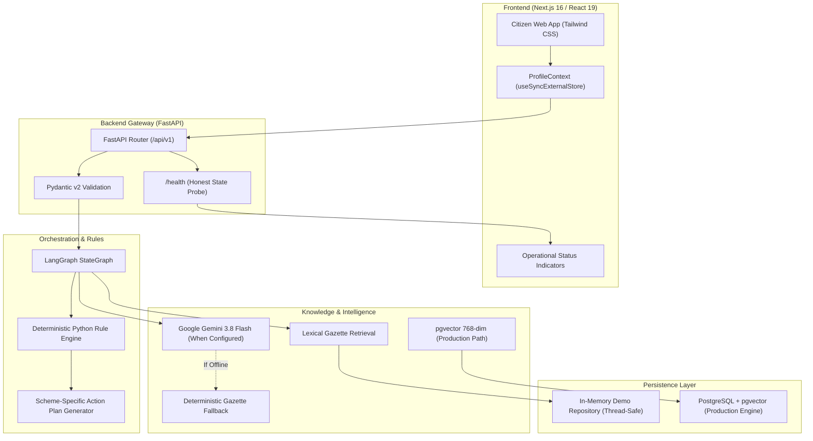
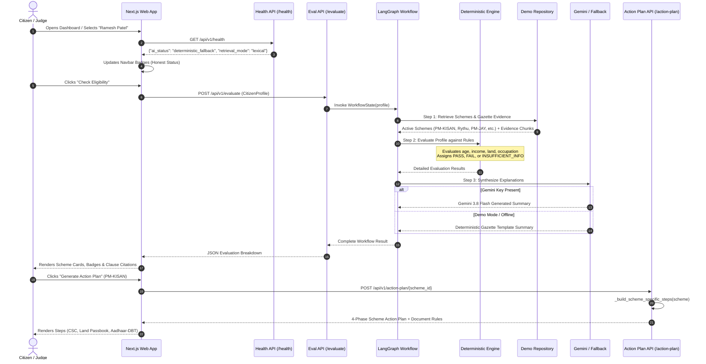

# PolicyPilot — Technical Architecture Explained
**Team Axiom | HACK-X 2026 | Generative & Agentic AI**
*Authors: Mariya Fatima (Team Lead), Nameera Sadaf, Shaik Rehan Ahmed*

---

## 1. High-Level Architecture Overview

PolicyPilot is engineered as a **modular monolith** with an audit-first, privacy-preserving decoupled architecture. It separates:
- **Presentation Layer:** Next.js 16 with React 19 and SSR-safe state synchronization.
- **API & Validation Layer:** FastAPI with strictly typed Pydantic v2 data models.
- **Rule & Logic Layer:** Pure deterministic Python eligibility engine.
- **Workflow Orchestration:** LangGraph state machine managing DAG execution and fallbacks.
- **Evidence & Retrieval Layer:** Dual-mode lexical (BM25-style gazette matching) and pgvector semantic retrieval.
- **Language Intelligence:** Google Gemini 3.8 Flash (online) or deterministic gazette synthesis (offline fallback).
- **Data Persistence:** In-memory demo repository for zero-dependency execution, with production async SQLAlchemy 2.0 and pgvector migration scripts.

---

## 2. Component Deep Dive: Simple vs. Technical Explanations

### A. Next.js 16 Frontend
- **In Simple Language:**
  A lightning-fast, accessible web interface that runs smoothly on mobile phones, tablets, and desktops. It formats all financial numbers in Indian Rupees (Lakhs and Thousands) and ensures the screen never flickers or crashes when refreshing.
- **In Technical Language:**
  - Built with **Next.js 16.0.7** using the **App Router** and **Turbopack** bundler.
  - State management uses React 19's **`useSyncExternalStore`** pattern in `apps/web/src/lib/profile-context.tsx`. This completely eliminates React hydration mismatches between Node.js SSR HTML (`getServerSnapshot`) and browser client storage (`getSnapshot`).
  - Strict currency formatting uses `Intl.NumberFormat("en-IN")` on both server and client to avoid SSR/CSR discrepancy (e.g., `1,20,000` vs `120,000`).
  - Zero decorative placeholders; every button, filter, and action plan connects to live backend endpoints.

### B. FastAPI Backend & Pydantic Validation
- **In Simple Language:**
  The server acts as a strict gatekeeper. If a citizen accidentally enters a negative income or impossible land size, the server catches it immediately with a friendly explanation before any processing happens.
- **In Technical Language:**
  - Implemented in **FastAPI** with asynchronous request handlers.
  - Strict data validation using **Pydantic v2** (`CitizenProfile`, `SchemeFilter`, `EvaluationRequest`).
  - Automatic OpenAPI / Swagger documentation exposed at `/docs`.
  - CORS middleware configured for secure local communication (`http://localhost:3000`).

### C. Deterministic Eligibility Engine
- **In Simple Language:**
  The digital judge. Instead of relying on an unpredictable AI to guess if you qualify, this engine uses exact mathematical rules (like: *Is your income less than or equal to ₹2,50,000?*). It produces an unchangeable, auditable report for every criterion.
- **In Technical Language:**
  - Located in `services/api/app/core/engine.py`.
  - Pure Python functions evaluating rule trees with boolean operators (`ALL`, `ANY`) and comparison operators (`EQUALS`, `LESS_THAN_OR_EQUAL`, `IN_LIST`, etc.).
  - Distinguishes 4 discrete outcomes:
    1. `PASS`: Condition met with verified profile data.
    2. `FAIL`: Condition violated.
    3. `INSUFFICIENT_INFORMATION`: Input field is null/missing; flags uncertainty instead of assuming rejection.
    4. `NEEDS_VERIFICATION`: Criterion rule is ambiguous or source is pending verification.
  - Never mutates input states; stateless, idempotent, and benchmarked at <40ms per evaluation.

### D. LangGraph State Machine
- **In Simple Language:**
  A strict manager that guides the application through clear steps: first normalizes profile attributes, matches schemes, checks conditional branches, executes the mathematical eligibility check, inspects missing info, retrieves gazette evidence, and synthesizes the action plan.
- **In Technical Language:**
  - Implemented using **LangGraph** (`StateGraph` in `services/api/app/ai/workflow.py`).
  - Maintains an immutable execution state (`WorkflowState`):
    - `raw_profile: Dict[str, Any]`
    - `normalized_profile: Dict[str, Any]`
    - `discovered_schemes: List[Dict[str, Any]]`
    - `evaluations: List[Dict[str, Any]]`
    - `missing_fields: List[str]`
    - `evidence_chunks: List[Dict[str, Any]]`
    - `action_plan: Dict[str, Any]`
    - `explanation: Dict[str, Any]`
    - `steps_log: List[Dict[str, Any]]`
  - Features real conditional branching via `route_after_discovery`: routes to `no_schemes_fallback` if zero schemes match, preventing erroneous pipeline traversal.

### E. Evidence Retrieval & Citations
- **In Simple Language:**
  A digital law library. For every scheme, it finds the exact paragraph in the government notification that proves why a rule exists, and gives you a working link to the ministry's website.
- **In Technical Language:**
  - Dual-mode architecture:
    - **Active Demo Mode:** Lexical indexing and multi-field exact matching over verified seed records in `services/api/app/demo/repository.py`.
    - **Production Mode:** 768-dimensional vector search powered by pgvector and Gemini Embedding 2 (`services/api/migrations/versions/001_initial_schema.py`).
  - Returns structured `EvidenceCitation` models containing clause references, publishers, and verified canonical URLs.

### F. Dual AI Strategy: Gemini 3.8 Flash & Deterministic Fallback
- **In Simple Language:**
  When internet and Google AI credentials are available, an advanced model (Gemini 3.8 Flash) writes smooth summaries. If the internet drops or no API key is present, the app doesn't crash—it seamlessly switches to pre-verified government templates and tells you honestly.
- **In Technical Language:**
  - Configured in `services/api/app/core/llm.py` and `health.py`.
  - Probes for `GEMINI_API_KEY`:
    - **Connected:** Dispatches structured generation prompts to `gemini-3.8-flash`. Status reports `"Gemini 3.8 Flash (Live)"`.
    - **Disconnected / Error:** Activates deterministic template synthesis. Status reports `"AI: Deterministic Fallback"`.
  - Sensitive API tokens are never sent to the browser or leaked in logs.

### G. In-Memory Demo Repository vs. PostgreSQL/pgvector
- **In Simple Language:**
  The hackathon prototype runs completely on your laptop without needing Docker or a cloud database, while having the complete blueprints ready to connect to a massive government database tomorrow.
- **In Technical Language:**
  - **Demo Repository:** Thread-safe, in-memory repository (`services/api/app/demo/repository.py`) populated from `seed/schemes.yaml`. Zero external dependencies.
  - **Production Repository:** Fully written SQLAlchemy 2.0 models (`services/api/app/db/models.py`) and Alembic migration (`001_initial_schema.py`) targeting PostgreSQL with `pgvector` enabled for 768-dimensional embeddings.

---

## 3. End-to-End Request Flow & Sequence Diagram

The sequence diagram below illustrates the exact end-to-end journey from citizen profile submission to verified action plan delivery:

---

## 4. Failure Modes and Fallback Resilience Matrix

PolicyPilot is built with a **defense-in-depth failure recovery strategy**:

| Failure Scenario | Upstream Symptom | PolicyPilot Handled Behavior | Resulting User Experience |
| :--- | :--- | :--- | :--- |
| **No Gemini API Key** | `GEMINI_API_KEY` missing from `.env` | Switches to deterministic gazette template synthesis | Navbar shows `AI: Deterministic Fallback`; 100% functional text |
| **Gemini API Outage / Rate Limit** | HTTP 429 / 503 from Google API | Trapped in `llm.py`; falls back to template branch | Citizen receives instantaneous gazette summary; 0 crashes |
| **PostgreSQL Unreachable** | No Docker or database server running | Bypasses SQL driver; routes queries to in-memory Demo Repository | Health reports `DB: Demo In-Memory`; instant local demo |
| **Missing Citizen Data** | Citizen omits landholding or caste | Engine flags `INSUFFICIENT_INFORMATION` | Amber uncertainty alert; prompts for specific missing document |
| **Government URL Migration** | Old `.nic.in` portal dead or 404 | Source registry updated with active canonical URLs (`.gov.in`) | Links open live portals (`pmayg.gov.in`, `pmkisan.gov.in`) |
| **SSR Hydration Discrepancy** | Node.js SSR vs Browser client storage | `useSyncExternalStore` synchronizes state after initial mount | Zero Next.js red issues; byte-identical initial DOM |

---

## 5. Security & Privacy Boundaries

1. **Zero Personally Identifiable Information (PII):**
   The application intentionally omits fields for Aadhaar numbers, PAN cards, voter IDs, phone numbers, and full home addresses.
2. **Stateless Processing:**
   Citizen evaluations are performed purely within request memory scope. No profiles are saved to persistent disk or forwarded to third-party ad networks.
3. **No Secret Leakage:**
   Environment variables and API keys remain strictly on the backend server. Health endpoints return only boolean or string status descriptors (e.g., `"deterministic_fallback"`), never API keys or connection strings.
4. **Sanitized External Navigation:**
   All external government links enforce `rel="noopener noreferrer"` and target `_blank` to protect the user's browser session.
